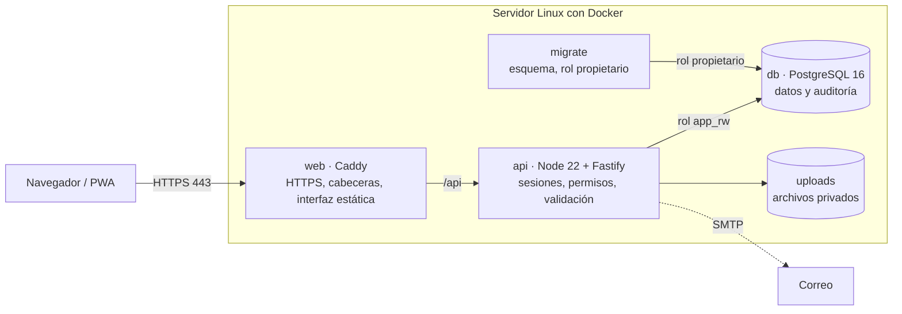

# Arquitectura (versión autoalojada)

Esta versión reemplaza el backend de Base44 por uno propio. **La interfaz casi no cambia**: solo se sustituyó el archivo que
habla con el servidor (`src/api/base44Client.js` → `src/api/selfhostedClient.js`), con la misma interfaz que usaban las páginas.

| Pieza | Qué hace | Por qué esta elección |
|---|---|---|
| **web** (Caddy) | Sirve la interfaz, reenvía `/api`, emite y renueva el certificado HTTPS, añade cabeceras de seguridad (CSP, HSTS…) | HTTPS automático sin configuración; muy pocas piezas que mantener |
| **api** (Fastify) | Login con sesión por cookie, permisos por rol **en el servidor**, validación de datos, archivos, auditoría | Rápido, validación integrada, ecosistema de seguridad maduro |
| **db** (PostgreSQL 16) | Datos, sesiones, auditoría | Transacciones, restricciones, respaldos probados |
| **migrate** | Crea/actualiza tablas e índices y termina | Separa el rol que cambia el esquema del rol que usa la API |

Red: solo `web` publica puertos (80/443). La base de datos vive en una red `internal` sin acceso a internet ni desde fuera.

## Modelo de datos

- **`users`** – cuentas, rol, bloqueo, contraseña (hash scrypt), contador de intentos.
- **`sessions`** – solo la huella SHA-256 del token; la cookie del navegador lleva el token.
- **`user_tokens`** – enlaces de un solo uso (invitación / restablecer), también solo con huella.
- **`records`** – todas las entidades de negocio (`Worker`, `DailyReport`, `PaymentClosing`…) con columnas `entity`, `id`, `data` (JSONB),
  `created_by`, `created_date`, `updated_date`. Cada entidad se define en `server/schemas/<Entidad>.json` (campos, tipos, obligatorios,
  enums, índices, campos únicos, **política de acceso** y campos sensibles).
- **`files`** – metadatos de archivos subidos (el contenido vive en el volumen `uploads`).
- **`audit_log`** – bitácora de seguridad de **solo agregar** (trigger que impide UPDATE/DELETE/TRUNCATE).

**Por qué JSONB y no una tabla por entidad.** El código original guarda documentos con algunos campos auxiliares y denormalizados
(nombres junto a ids). JSONB conserva esa flexibilidad sin migraciones para cada cambio, y el servidor valida cada campo conocido con JSON
Schema, aplica unicidad con índices y filtra con índices GIN. Si más adelante necesitas reportes SQL pesados, se pueden crear vistas por entidad
(`CREATE VIEW v_worker AS SELECT data->>'full_name' …`) sin tocar la aplicación.

Los 15 esquemas (14 en `schemas/` + `User` en su propia tabla) se **derivaron leyendo el código de las páginas**; no había definiciones en el repositorio.
Antes de migrar datos reales, valida con `npm run import -- <Entidad> <archivo> --dry-run` (ver `MIGRACION-BASE44.md`).

## API

Todas las rutas van bajo `/api`, responden JSON y exigen sesión (salvo las de acceso). Las que modifican datos exigen el encabezado
`X-Requested-With: labores` (protección CSRF).

| Método y ruta | Uso |
|---|---|
| `POST /api/auth/login` · `POST /api/auth/logout` · `GET /api/auth/me` | Sesión |
| `POST /api/auth/forgot` · `POST /api/auth/set-password` · `POST /api/auth/change-password` | Contraseñas |
| `POST /api/users/invite` | Alta de usuarios (solo admin) |
| `GET /api/entities/:E?sort=&limit=&skip=` | `list` |
| `POST /api/entities/:E/query` `{where, sort, limit, skip}` | `filter` (igualdad, `$in`, `null`) |
| `GET/PATCH/DELETE /api/entities/:E/:id` · `POST /api/entities/:E` · `POST /api/entities/:E/bulk` | `get`, `update`, `delete`, `create`, `bulkCreate` |
| `POST /api/files` · `GET /api/files/:id/:nombre` | Archivos (privados, requieren sesión) |
| `GET /api/health` | Salud (sin datos) |

Límites: 1000 registros por lista por defecto (máximo 10 000), 1000 por carga masiva, 10 MB por archivo, cuerpo de 4 MB.

## Decisiones y compromisos conocidos

- **Sin tiempo real.** Esta app no usa suscripciones; `subscribe` devuelve una función vacía. (`assettrack-pro` sí las usa y requeriría SSE.)
- **Cierres de pago no transaccionales.** La interfaz crea el cierre y luego actualiza cada reporte en llamadas separadas (igual que con Base44).
  Si falla a la mitad puede quedar un cierre sin todos sus reportes marcados. Mejora recomendada: un endpoint `POST /api/payment-closings` que lo haga en una transacción.
- **Sin control de concurrencia optimista.** Dos personas editando el mismo registro a la vez: gana la última (como en Base44).
- **Un solo servidor.** No hay alta disponibilidad; la protección es el respaldo (ver `DESPLIEGUE.md`).
